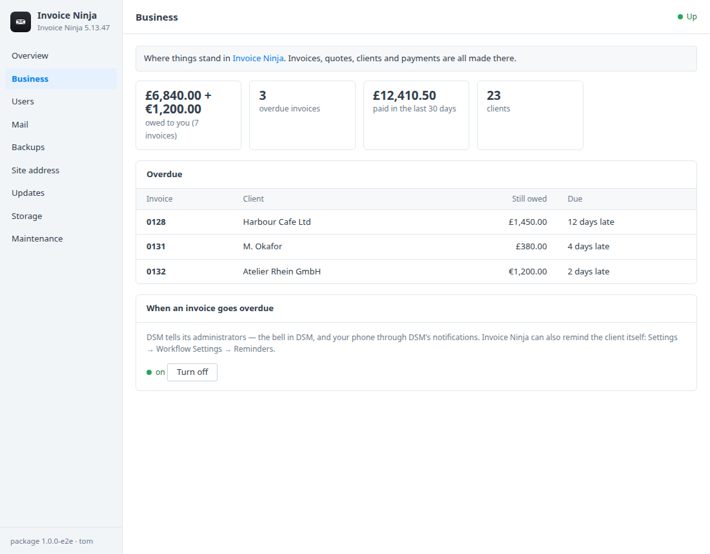
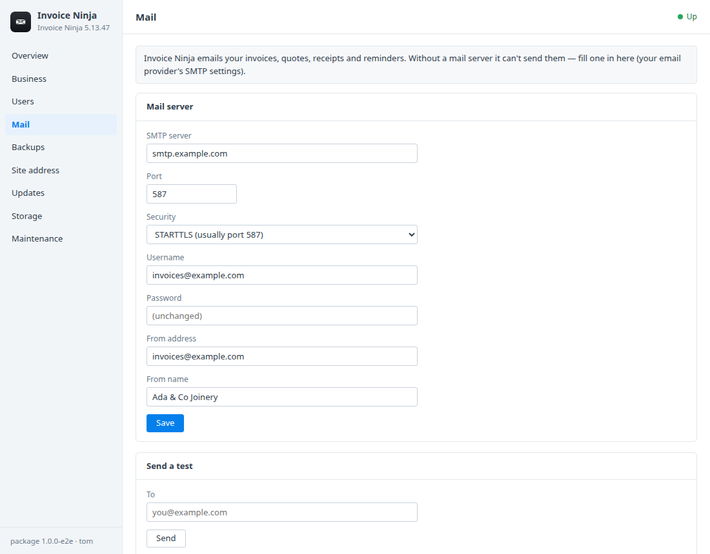
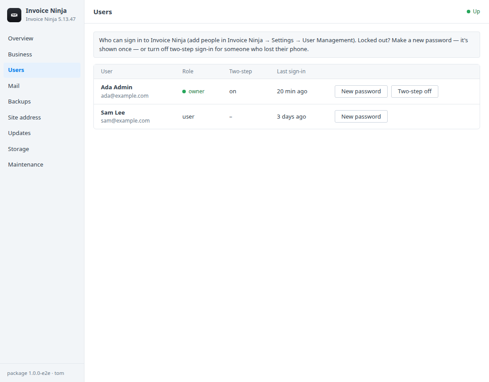

# Invoice Ninja for Synology DSM

A DSM 7 package that installs [Invoice Ninja](https://invoiceninja.com) in
Container Manager with MariaDB. Invoice Ninja handles invoices, quotes,
payments, expenses and time for freelancers and small businesses, and your
clients' details and your figures stay on your Synology. A DSM window adds:
- what's owed and what's **overdue**, with a DSM notification when an invoice
  goes overdue;
- users and their passwords;
- the **mail server** that sends your invoices;
- HTTPS with DSM's certificate;
- consistent backups and updates.

Built on the [DSM app chassis](https://github.com/tombruton87/dsm-app-chassis).

## Download

### **[⬇ Download invoiceninja.spk](https://github.com/tombruton87/invoiceninja-dsm/releases/latest/download/invoiceninja.spk)**

[](https://github.com/tombruton87/invoiceninja-dsm/releases/latest)

That link always gives the newest version. Older ones are on the
[Releases](https://github.com/tombruton87/invoiceninja-dsm/releases) page.

Install: Package Center → Manual Install → the `.spk` (DSM 7.2.1+; Container
Manager is installed first if missing). The wizard asks for:
- the NAS's address;
- a port (8012 by default);
- a time zone;
- your email and name;
- HTTPS.

The first start sets up the database, which takes a few minutes. Your account's
password is then shown once in the window.

Your clients open invoices through links, so give Invoice Ninja an address
they can reach: DSM's reverse proxy with a domain and a trusted certificate.

## What the DSM window adds

- **Business**
  - What's owed to you and on how many invoices.
  - Overdue invoices: number, client, amount still owed, days late.
  - What's been paid in the last 30 days, and the number of clients.
  - Amounts are in each client's currency.
- **When an invoice goes overdue** — a DSM notification for each invoice that
  newly goes overdue (a summary when there are many). Invoice Ninja can also
  remind the client itself (Settings → Workflow Settings → Reminders).
- **Users** — a new password (shown once), or two-step sign-in off for
  someone who lost their phone.
- **Mail** — Invoice Ninja has no mail settings page of its own for the
  server, so they're here: SMTP server, security, From address and name, and a
  test email. Without it, invoices can't be emailed.
- **Site address** — HTTPS served by nginx in front, with DSM's certificate
  (the system default; renewals are picked up daily) or a self-signed one.
  Invoice Ninja's own links follow.
- **Backups, updates, storage, maintenance** — one file holds:
  - a consistent MariaDB dump (clients, invoices, payments, settings);
  - every uploaded logo and document;
  - the app key.

  Backups run nightly or on demand, with restore. You can also:
  - update to newer images or a newer package from inside DSM;
  - make a redacted support report;
  - read the logs;
  - remove Invoice Ninja and everything with it.

## Screenshots

| | |
|---|---|
|  |  |
|  | |

## How it works

Three containers:
- **app** (`invoiceninja/invoiceninja-debian:5`): PHP, the queue worker and
  the scheduler;
- **web** (`nginx`), in front, with the HTTPS certificate;
- **db** (`mariadb:11.4`, on UTC as Laravel expects).

The queue, cache and sessions use the database and files, so Redis isn't
needed.

The image creates its first account only from an email and password in its
environment, and won't start without them. So the first start gets a
throwaway password. Straight after, the package sets your real password
through Invoice Ninja's own models: a short PHP script piped into the
container, with the password on stdin. It shows that password once and takes
the throwaway out of the environment.

The window reads MariaDB. Your password is never stored.

## Layout

```
chassis/          the DSM app chassis (git submodule)
package.conf      name, title, services, volumes, images, port, texts
app/compose.yaml  app, web (nginx) and db (MariaDB)
setup/app.sh      the hooks: your account, overdue alerts, mail, HTTPS (nginx), backups
setup/in.php      Invoice Ninja's own models, for passwords, two-step sign-in and the test email
ui/               Business, Users and Mail tabs; CGI validation (free text travels base64url)
wizard/           the Invoice Ninja page of the install wizard
tests/            steps for the chassis harness (clients and invoices through its API, Mailpit)
```

Test: `chassis/tests/e2e.sh . up && chassis/tests/e2e.sh . act` on any Linux
box with Docker.

Release: bump `VERSION`, add the changes to `CHANGELOG.md`, build, then attach
the package twice, under its versioned name and as `invoiceninja.spk`:

```bash
cp dist/invoiceninja-X.Y.Z-1.spk /tmp/invoiceninja.spk
gh release create vX.Y.Z dist/invoiceninja-X.Y.Z-1.spk /tmp/invoiceninja.spk
```

Build: `chassis/build.sh . N`.

## Credits

The icon is Invoice Ninja's own mark on a dark DSM-style tile. Invoice Ninja
is source-available software by Invoice Ninja LLC (Elastic License 2.0 for
the self-hosted version; its white-label and some features are paid). This
package is not affiliated with Invoice Ninja or Synology.
